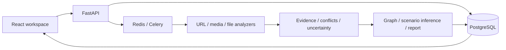

# ThreatGraph AI

**Digital Trust & Fraud Investigation Platform**

**Latest local MVP work:** working ClamAV scanning, restricted browser inspection, accessible form-question detection, shared actionable UI/PDF summaries, and a 3,292-image training/evaluation experiment. See [local run commands, validation, and remaining limits](docs/MVP_LOCAL_VALIDATION.md).

Investigate digital content before you trust it. ThreatGraph groups suspicious links, messages, emails and uploads into cases; follows QR destinations; correlates repeated entities; and explains evidence-based fraud patterns. Risk, confidence and uncertainty remain separate.

**Current status:** working local research application with image/URL classifiers, an experimental temporal video checkpoint, local malware scanning, website collection checks, persistent reports, interactive graphs and responsive light/dark pages. Image v3 achieved **98.5% accuracy on a fresh 600-image local benchmark**, versus 76.17% for unchanged v2 on the same images, with fewer missed AI images and false positives. Upstream training overlap cannot be excluded; general-purpose field accuracy is **not established**. Audio cloning and independent video validation remain incomplete. See [measured image comparison](docs/IMAGE_V3_RESULTS.md), [security capabilities](docs/SECURITY_CAPABILITIES.md) and [implementation status](docs/IMPLEMENTATION_STATUS.md).

The installed image model uses official pretrained Community Forensics weights at `models/image/community-forensics-384/model.safetensors`, with locally fitted calibration. Earlier project-trained checkpoints are retained. Binaries and datasets are excluded from Git. See [v3 protocol](docs/IMAGE_V3_PROTOCOL.md), [reproduction commands](docs/ML_PIPELINE.md), and [video screening](docs/VIDEO_SCREENING.md). Image origin is separate from security risk, and uncertain predictions remain visible.

The current investigation upgrade adds [case, correlation, fraud and privacy features](docs/PRODUCT_UPGRADE_STATUS.md). Start with a URL, file, pasted message or `.eml` email; group related results under **Cases**; inspect shared entities under **Intelligence graph**; export JSON or PDF. Docker enables accounts by default. Register, then promote the first case investigator with `docker compose exec backend python scripts/manage_account.py your@email.example --role ANALYST`. The [deployment guide](docs/DEPLOYMENT.md) covers local mode, account mode and current verification limits.


## Start

```sh
docker compose up --build
```

Open **http://localhost:3000**. API/OpenAPI docs: **http://localhost:8000/docs**. Models mount from `models/`; setup is described separately in [ML pipeline](docs/ML_PIPELINE.md). Docker includes PostgreSQL, Redis, worker, retention scheduler, API and frontend. See [deployment](docs/DEPLOYMENT.md) for a lightweight native SQLite development setup and current verification limits.

## What works

- URL/file submission, MIME inspection, SHA-256 and MD5 compatibility hashes, real progress and persistent history.
- Defensive URL fetching with public-address validation, DNS pinning, redirect checks and recursion/download limits.
- Real calibrated URL ML plus static password-form, off-domain submission, brand and urgency findings.
- Image metadata, perceptual hashes, descriptive recompression error, QR extraction, optional OCR and local C2PA verification.
- Audio decoding/waveform, video frame QR scanning and optional FFmpeg audio extraction; model inference when registered checkpoints exist.
- PDF QR inspection and bounded archive inventory; optional ClamAV and opt-in URLhaus reputation.
- Explicit same-asset evidence conflicts, missing-modality masks, transparent risk contributions and manual-review verdicts.
- Interactive graph zoom/pan, node inspection, severity filters, path tracing, dashboard and JSON report export.
- Reproducible model scripts and research ablations that require genuine data rather than manufactured scores.

## Architecture



Stack: React, TypeScript, React Query, Cytoscape, Recharts, FastAPI, Pydantic, SQLAlchemy/Alembic, PostgreSQL, Redis/Celery, scikit-learn, PyTorch/torchvision, OpenCV, Pillow, FFmpeg, C2PA. [Architecture details](docs/ARCHITECTURE.md).

## Data, training, and real results

The local URL checkpoint was trained on 30,000 UCI PhiUSIIL records with domain-grouped splits. Selected histogram gradient boosting achieved **test F1 0.994170, PR-AUC 0.997773** on 5,787 held-out rows. An external spot-check falsely flags benign `example.com`, demonstrating poor generalization despite that score. The checkpoint is explicitly experimental and its deployed confidence is capped to require manual review. [Exact metrics, observed failure and caveats](docs/RESEARCH.md).

```powershell
$env:PYTHONPATH='backend;.'
.\.venv\Scripts\python.exe -m ml.url_detector.train --data-dir datasets/prepared/urls.csv --output-dir models/url-new-run --max-rows 30000 --seed 42
.\.venv\Scripts\python.exe -m ml.image_detector.train --data-dir datasets/prepared/image --output-dir models/image --epochs 15 --batch-size 16
.\.venv\Scripts\python.exe -m ml.audio_detector.train --data-dir datasets/prepared/audio --output-dir models/audio --epochs 15 --batch-size 16
.\.venv\Scripts\python.exe -m ml.video_detector.train --data-dir datasets/prepared/video --output-dir models/video --epochs 15 --batch-size 16
```

Prepare approved datasets first. [Licenses and preparation](docs/DATASETS.md), [training/evaluation commands](docs/ML_PIPELINE.md), [model registry](models/README.md). Checkpoints/datasets are excluded from Git. Research scripts export tables and ROC/PR/calibration/confusion/ablation plots once real labeled multimodal data is supplied.

## Safe demonstration

```sh
python datasets/scripts/create_demo.py
```

Upload `datasets/demo/simulated-phishing.html` for genuine static heuristic findings, `qr-example.png` for bounded QR → public URL discovery, `illustration.png` for image forensics, `tone.wav` for audio metadata/waveform, and `shapes.avi` for video metadata. These are clearly labeled test signals, not natural-photo/deepfake benchmarks. The recursive multi-hop phishing chain is covered by an isolated integration test with mocked network transport and real QR decoding. No real malicious site is needed. A genuine audio/visual deepfake conflict demo requires installed trained models and an approved sample; it is not fabricated.

## Verification and documentation

Backend: `python -m pytest`. Frontend: `npm test`, `npm run build`, `npm run test:e2e` inside `frontend/`. Tests exercise SSRF, MIME, QR recursion, conflicts, risk, graph, uploads and persistence. Browser tests use actual local API responses, inspect all important pages, and save screenshots. [API](docs/API.md), [security/privacy](docs/SECURITY.md), [research](docs/RESEARCH.md), [deployment](docs/DEPLOYMENT.md).

## Privacy and limitations

Private files stay local. `PRIVACY_MODE=true` disables external reputation. Original upload retention defaults to 24 hours; report metadata persists and may contain sensitive excerpts/EXIF. The default risk fusion is an explicitly uncalibrated rule baseline until a learned checkpoint is trained and installed. No absent credential, unavailable model, or empty report is interpreted as proof of authenticity or safety.

This is a local single-user research application, not a publicly deployable multi-tenant service. Authentication, robust tenant isolation, calibrated selective-risk thresholds, complete media benchmarks, external URL evaluation, temporal face tracking and verified research claims remain unfinished. Future work should prioritize those items before adding more model complexity.
