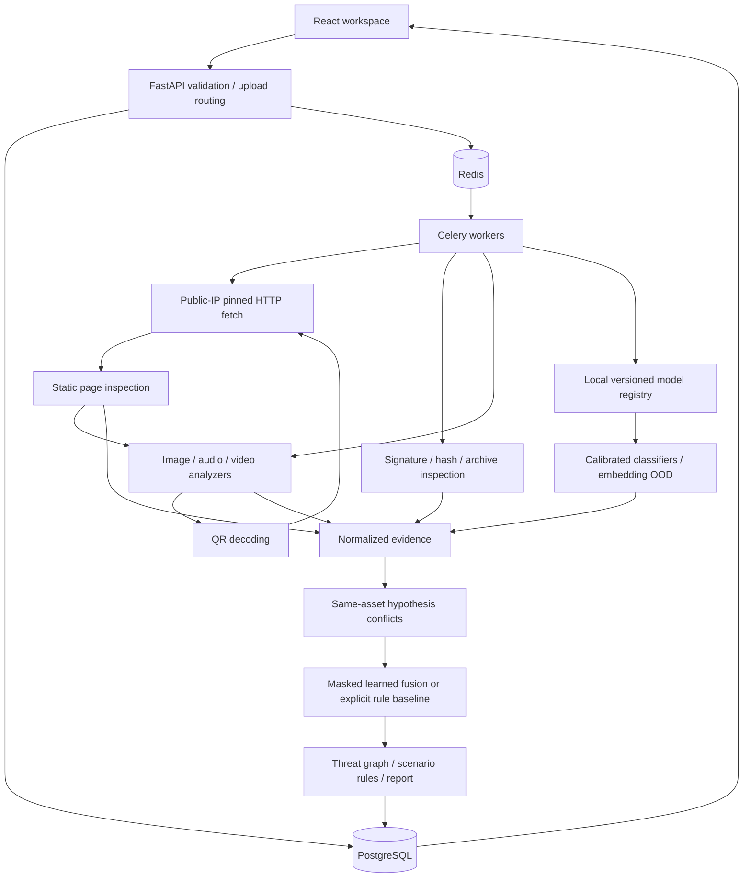

# Architecture

ThreatGraph AI is a local single-user investigation application. React/Vite and TypeScript are used instead of Next.js: this dashboard needs no server-rendered content, and a static frontend keeps deployment simpler. CSS uses a documented set of tokens and native accessible form controls rather than an additional component framework.

The URL router validates schemes, credentials, ports and literal IP addresses. A custom aiohttp resolver rejects every nonpublic answer and returns numeric addresses to the connector, avoiding a second DNS lookup. Every redirect repeats validation. Remote pages are parsed without a browser or JavaScript. Images and downloads have a depth limit, asset limit, and total byte budget. Uploaded HTML never automatically fetches embedded resources; decoded QR URLs are explicit investigation targets and use the guarded fetcher.

Evidence carries asset ID, source, category, score (nullable), confidence, uncertainty, severity, explanation, model version and metadata. Missing observations are null, not zero. Conflicts require the same asset and hypothesis; cross-asset predictions are not falsely compared. Provenance absence is neutral.

SQLAlchemy persists analyses, assets, detector results, evidence, conflicts, graph nodes/edges, fraud scenarios and model versions. A users table reserves future identity support; authentication is not implemented. Evidence tables use versioned JSON payloads with analysis foreign keys. The report is also materialized on the analysis for fast reads. PostgreSQL is the deployment database; SQLite is a local development fallback.

Local development uses a bounded two-thread executor so requests return promptly. This mode is not durable across process restarts. Docker uses Redis/Celery and a separate retention scheduler. Models load lazily once per worker per checkpoint modification time. CPU-heavy media work is isolated from the API process in Docker, with memory/PID bounds and non-root containers.
